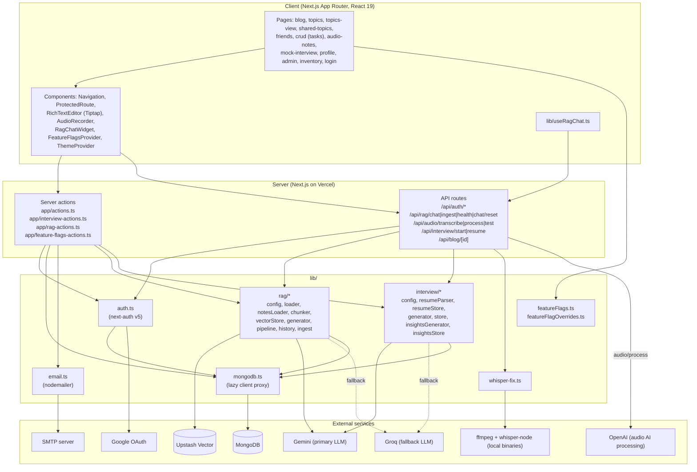
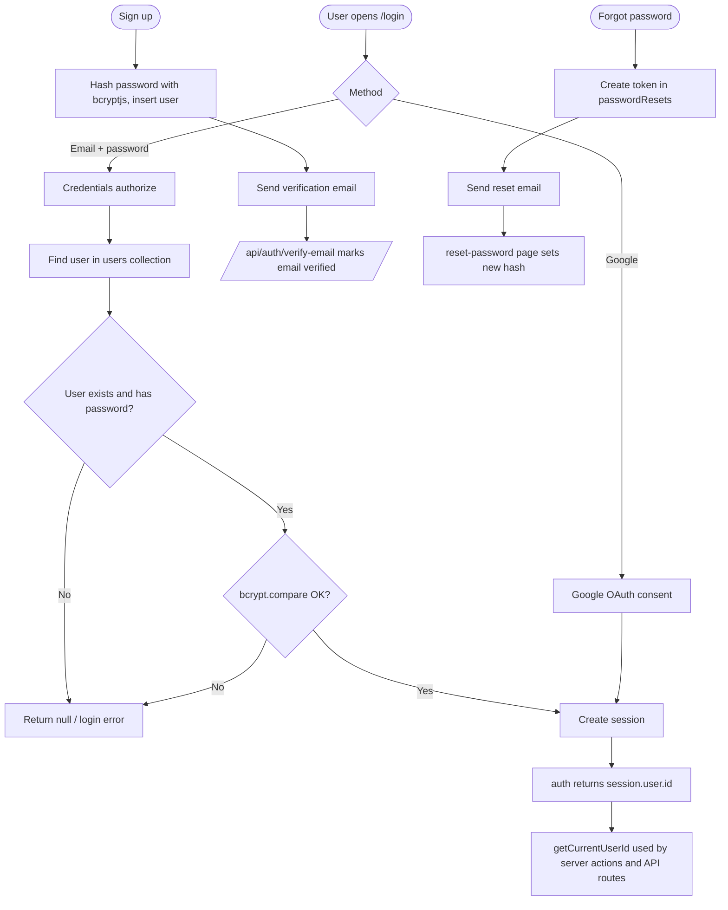
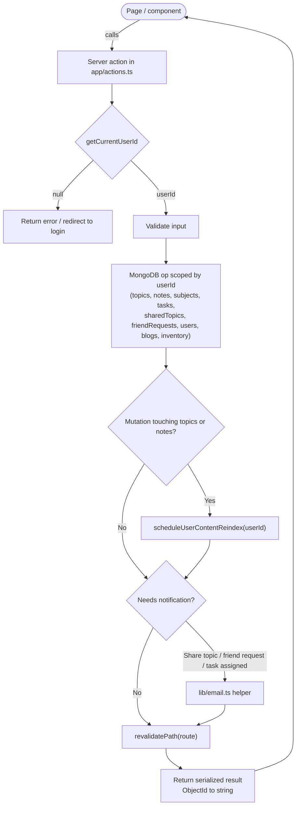
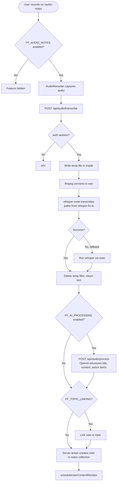
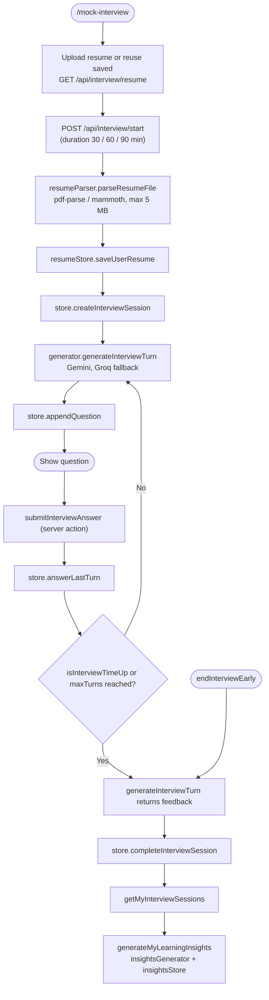
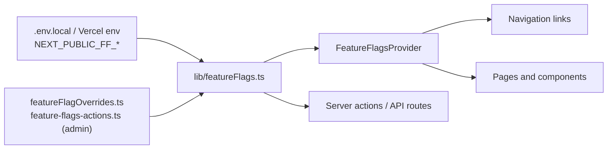

# Denotes: Low-Level Design

Mermaid diagrams render on GitHub and in most Markdown viewers.

## 1. System overview (layers and dependencies)

## 2. Authentication and session

## 3. Core CRUD server action flow (topics, notes, tasks, friends, sharing)

## 4. Audio notes flow

## 5. RAG chat: ingest and query

```mermaid
flowchart TD
    subgraph Ingest
        I1([npm run rag:ingest or POST /api/rag/ingest<br/>with RAG_INGEST_SECRET]) --> I2[loader.ts fetches URLs<br/>docs, blog, public topics]
        I3([Notes / topics mutation]) --> I4["scheduleUserContentReindex(userId)"]
        I4 --> I5[notesLoader.ts reads user notes and topics from MongoDB]
        I2 --> CH[chunker.ts<br/>size 800, overlap 150]
        I5 --> CH
        CH --> ST["vectorStore.storeChunks(chunks, namespace)"]
        ST --> NS{Namespace}
        NS -->|public| UP1[(Upstash default)]
        NS -->|personal| UP2[("Upstash user:id")]
    end

    subgraph Query
        Q1([User asks in RagChatWidget / RagChatMainStage]) --> Q2["useRagChat → POST /api/rag/chat"]
        Q2 --> Q3{auth session?}
        Q3 -->|No| Q3a[401]
        Q3 -->|Yes| Q4["pipeline.chat(userId, sessionId, question)"]
        Q4 --> Q5[history.getHistory from MongoDB]
        Q4 --> Q6["vectorStore.retrieveForUser<br/>public + user namespace, top K merged by score"]
        Q5 --> Q7
        Q6 --> Q7["generator.generateAnswer(question, history, context)"]
        Q7 --> Q8{Gemini ok?}
        Q8 -->|Quota / rate limit| Q9[Groq fallback]
        Q8 -->|Yes| Q10
        Q9 --> Q10[Answer + source URLs]
        Q10 --> Q11[history.appendTurn]
        Q11 --> Q12([Return to client])
        Q13([POST /api/rag/chat/reset]) --> Q14[history.clearSession]
    end
```

## 6. Mock interview flow

## 7. Feature flag gating

## 8. MongoDB collections

`users`, `topics`, `notes`, `subjects`, `tasks`, `sharedTopics`, `friendRequests`, `passwordResets`, `blogs`, `blogComments`, `inventory`, `families` (feature disabled by default). RAG chat history and interview sessions, resumes and insights are stored through `lib/rag/history.ts` and `lib/interview/*Store.ts`.
